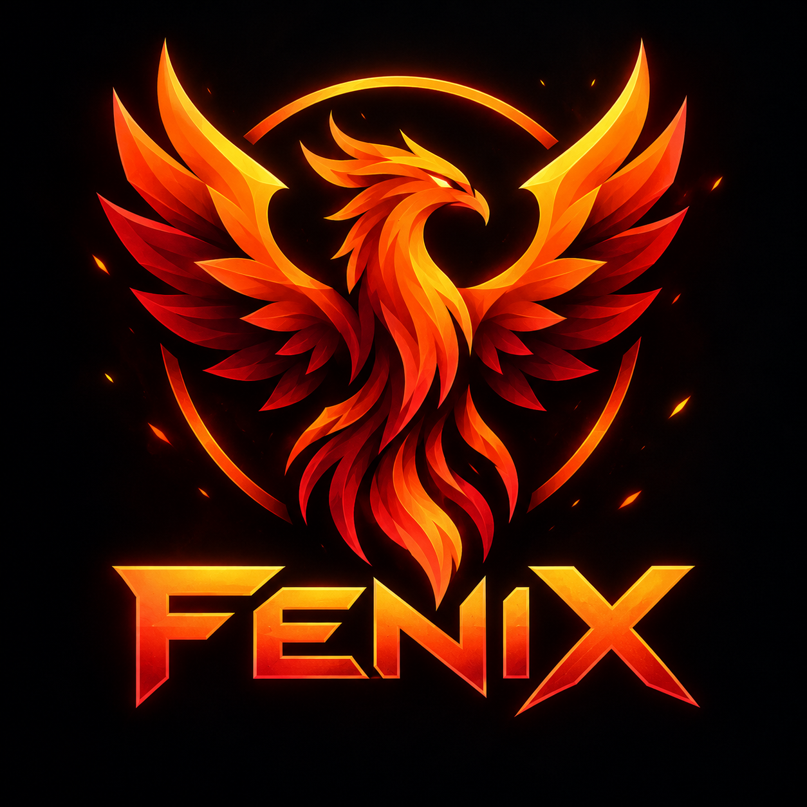

<div align="center">
  
  <h1>🦅 FenixCraft Launcher</h1>
  <p><b>Официальный кроссплатформенный лаунчер игрового проекта FenixCraft</b></p>

  
  
  
</div>

---

## 📌 О проекте

**FenixCraft Launcher** — лаунчер Minecraft на **Tauri v2** и **Rust**. Он скачивает клиент и Java, синхронизирует файлы сборок с сервером проекта и запускает установленные сборки без интернета.

## ✨ Возможности

* 🎮 **Сборки:** Vanilla 26.3 и NeoForge 1.21.1 с автоматической установкой, а также их варианты с Iris и Sodium для шейдеров. Список хранится в `src-tauri/core/src/config.rs`. Если основной сервер NeoForge недоступен, используется зеркало.
* 🗂️ **Отдельные папки:** у каждой сборки свои моды, настройки и миры в `instances/<сборка>`, поэтому моды разных загрузчиков не конфликтуют. Версии, библиотеки, ресурсы и Java общие и скачиваются один раз. При первом запуске новой версии миры, скриншоты, ресурс-паки и шейдеры из общей папки переносятся в выбранную сборку.
* 📴 **Работа без сети:** ванильная версия после первой полной загрузки запускается без интернета. Если файлов не хватает, лаунчер объясняет, что нужно докачать. Сборкам с модами нужен сервер сборок: без него лаунчер показывает «Технические работы».
* 🔒 **Проверка файлов:** каждый скачанный файл сверяется по SHA-1 или SHA-256 и заменяет старый только после проверки. Пути из внешних данных не могут выйти за папку игры.
* ☕ **Java:** подходящая Java находится на компьютере или скачивается с Adoptium с проверкой контрольной суммы.
* 👤 **Профиль:** «Пиратка» — ник применяется сразу. «Лицензия» — вход через Microsoft по коду, игра получает настоящую сессию.
* 🔄 **Обновления:** проверка через GitHub Releases; установщик скачивается только из релизов этого репозитория.
* 🌐 **Сервисы проекта:** статус серверов, новости ВКонтакте с сохранением на случай отсутствия сети, индикатор стрима на Twitch, магазин.
* 🛠️ **Диагностика:** консоль с выводом игры, полная проверка ресурсов, сохранение журнала, понятные сообщения об ошибках.

## 🏗️ Стек

* **Приложение:** Rust, Tauri v2
* **Логика лаунчера:** крейт `fenix-core` без зависимости от Tauri, что позволяет тестировать её отдельно
* **Интерфейс:** HTML, JavaScript (ES-модули), Tailwind CSS, собранный локально
* **Бекенд:** Python, FastAPI

## 🚀 Разработка

Нужны [Rust](https://rustup.rs) и Node.js 20+. На Linux дополнительно:

```bash
sudo apt-get install -y libwebkit2gtk-4.1-dev libappindicator3-dev librsvg2-dev patchelf libasound2-dev libssl-dev libdbus-1-dev
```

```bash
git clone https://github.com/BloodRayT/launcher.git
cd launcher
npm ci
```

```bash
npm run tauri dev
```

Сборка установщиков под текущую ОС:

```bash
npm run tauri build
```

### Проверки

Те же проверки выполняет CI на каждый pull request.

```bash
npm test
npm run check:versions
```

```bash
cd src-tauri && cargo fmt --all --check && cargo clippy --workspace --all-targets -- -D warnings && cargo test -p fenix-core
```

```bash
cd backend && pip install -r requirements-dev.txt && python -m pytest tests
```

Проверка на настоящих серверах Mojang с запуском игры. Она откроет окно Minecraft:

```bash
cd src-tauri && cargo run -p fenix-core --example smoke_launch -- /путь/к/пустой/папке 26.3-vanilla 45
```

### Выпуск версии

Версия указывается в `package.json`, `src-tauri/Cargo.toml` и `src-tauri/tauri.conf.json` и должна совпадать с git-тегом `vX.Y.Z`. Иначе сборка релиза остановится. Релиз создаётся черновиком, чтобы перед публикацией можно было дописать описание изменений.

## 🖥️ Бекенд

Настройки передаются через переменные окружения, образец находится в `backend/.env.example`. Файлы сборок проверяются по контрольным суммам SHA-256 из манифеста.

Если бекенд недоступен, лаунчер работает автономно: ванильные версии запускаются как обычно, а сборки с модами показывают «Технические работы» и не запускаются, чтобы игрок не попал на сервер с устаревшими файлами. Если для сборки на бекенде просто нет файлов (ответ 404), она запускается.

Сейчас сайт работает только по HTTP. Контрольная сумма приходит тем же незащищённым каналом, что и файл, поэтому защищает от повреждения при загрузке, но не от подмены в сети. Когда появится HTTPS, смените `BASE_PUBLIC_URL` и адрес по умолчанию в `src-tauri/core/src/config.rs`.

Новости и статус стрима идут через бекенд, поэтому токены VK и Twitch хранятся только на сервере.

### Установка на Ubuntu 24

Скрипт ставит Docker, запускает бекенд в `/opt/fenixcraft` и подключает адрес `/api/launcher/` к веб-серверу, который уже отдаёт сайт из `/var/www/html` (Apache или nginx). Сам сайт не меняется.

```bash
curl -fsSL https://raw.githubusercontent.com/BloodRayT/launcher/main/backend/deploy/install.sh | sudo bash
```

Файлы сборки кладутся в `/opt/fenixcraft/backend/storage/<сборка>/` (`mods`, `shaderpacks`, `resourcepacks`, `config`, `options.txt`), перезапуск не нужен. Для `1.21.1-iris-neoforge` нужны Sodium и Iris в версиях для NeoForge 1.21.1. Порт 8000 открыт только для веб-сервера на этом же сервере.

## 🔑 Вход через Microsoft

1. Зарегистрируйте приложение на [портале Azure](https://portal.azure.com): App registrations → New registration, тип учётных записей «Personal Microsoft accounts only». В разделе Authentication включите «Allow public client flows». Секрет приложения не нужен.
2. Подайте заявку на доступ к Minecraft API: [aka.ms/mce-reviewappid](https://aka.ms/mce-reviewappid). Пока её не одобрят, сервис отвечает ошибкой 403 и лаунчер сообщит об этом игроку.
3. Добавьте Client ID в переменную репозитория `FENIX_MS_CLIENT_ID` на GitHub (Settings → Secrets and variables → Actions → Variables). Для локальной сборки задайте переменную окружения с тем же именем.

Refresh-токен хранится в системном хранилище (на Windows — Диспетчер учётных данных), токен Minecraft только в памяти.

## 📂 Структура

```text
launcher/
├── .github/workflows/      # CI и сборка релизов
├── backend/                # Сервер сборок (FastAPI), файлы сборок в storage/
├── scripts/                # Проверка совпадения версий
├── src/                    # Интерфейс
├── src-tauri/
│   ├── core/               # fenix-core: скачивание, проверка, запуск игры и тесты
│   ├── src/                # Команды Tauri, новости, статус серверов
│   └── tauri.conf.json     # Окно, CSP, сборка
└── tests/                  # Тесты интерфейса
```

## 🤝 Сообщество и контакты

* Официальный сайт: [fenixcraft.ru](http://fenixcraft.ru)
* Сообщество ВКонтакте: [vk.ru/fenixcraft](https://vk.ru/fenixcraft)
* Twitch: [twitch.tv/bloodrayt](https://www.twitch.tv/bloodrayt)
* IP сервера: `play.fenixcraft.ru:25565`
